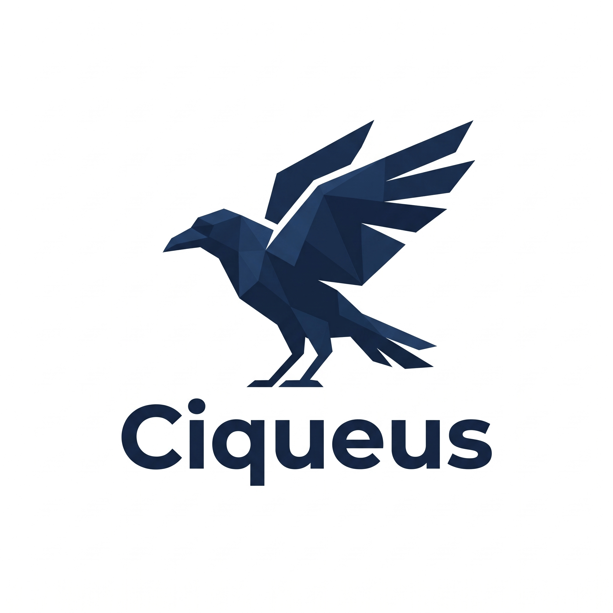

<div align="center">
  
</div>

# CIQUEUS API 

## Conceito 

Uma API de **questões de concurso/vestibular/provas** para ser implementada em _sites educacionais_ 

## Tecnologias

* Python
    * PyMuPDF
    * OpenCV
    * Pydantic
    * Pytesseract
* JavaScript Vanilla
* CSS3
* HTML5

* MarkerPDF (Vik Paruchuri / Datalab)
* DocLayout-YOLO 
* PostgreSQL 

## Fluxo do Sistema

### Cadastro de Questão 

→ Entrar no sistema → Clicar em cadastrar a questão → Escolher a opção (manual ou digitalizar) → Caso seja a digitalização ocorrerá → Foto ou PDF → Identificar o tipo de OCR (OCR de Foto ou OCR de PDF) → Identificar a Foto ou Identificar  o PDF → Requisitar o gabarito → Escolher o modo do gabarito (Manual ou Digitalizado):
  - **Se Manual:** Preencher/fazer o registro da questão identificada e digitar o gabarito.
  - **Se Digitalizado:** Fazer o reconhecimento do gabarito → Aplicar OCR (OCR de Foto ou OCR de PDF) → Fazer o registro do texto do gabarito → Questão registrada.

## Estilização da Aplicação 

```CSS
--black: #000000ff;
--prussian-blue: #14213dff;
--orange: #fca311ff;
--alabaster-grey: #e5e5e5ff;
--white: #ffffffff;
```

## Como subir para produção? 

Para subir essa aplicação para produção será necessário uma VPS por causa do OCR que torna-se pesado. 


## Referência Bibliográfica 

* minhaprova.com.br 


